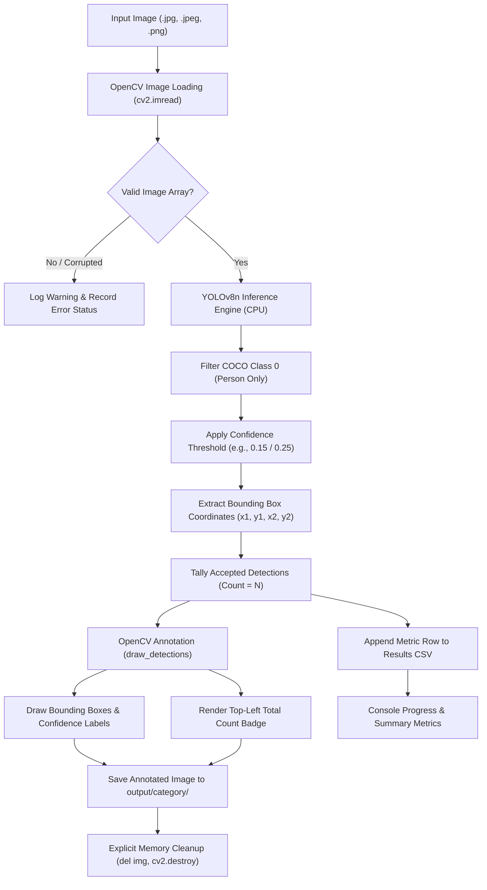

# CROWD ESTIMATION USING YOLO AND OPENCV ON RASPBERRY PI

A modular, lightweight computer vision framework designed for automated crowd headcount estimation on CPU architectures, including standard personal computers and edge embedded single-board computers such as the **Raspberry Pi 4**.

> [!IMPORTANT]
> **Privacy and Detection Scope Notice**:
> This project performs **person detection** exclusively (localizing human silhouettes using COCO class ID `0`).
> It **DOES NOT** perform facial recognition, facial landmarking, biometric scanning, personal identification, or unique-person tracking across frames. Each detection counts an instance of a detected human figure within a static image.

---

## Table of Contents
- [1. Project Title](#1-project-title)
- [2. Project Overview](#2-project-overview)
- [3. Problem Statement](#3-problem-statement)
- [4. Project Objectives](#4-project-objectives)
- [5. Project Scope](#5-project-scope)
- [6. System Architecture](#6-system-architecture)
- [7. Technology Stack](#7-technology-stack)
- [8. Hardware Requirements](#8-hardware-requirements)
- [9. Software Installation](#9-software-installation)
- [10. Dataset Structure](#10-dataset-structure)
- [11. How to Run the Project](#11-how-to-run-the-project)
- [12. Output Explanation](#12-output-explanation)
- [13. Verified Results and Performance Analysis](#13-verified-results-and-performance-analysis)
- [14. Model Improvement and Optimization](#14-model-improvement-and-optimization)
- [15. Limitations and Future Work](#15-limitations-and-future-work)

---

## 1. Project Title

**CROWD ESTIMATION USING YOLO AND OPENCV ON RASPBERRY PI**

---

## 2. Project Overview

Estimating crowd sizes in civic spaces, transit terminals, public squares, educational venues, and community events is vital for public safety, space allocation, event logistics, and crowd movement management. 

Traditional enterprise surveillance systems often rely on power-hungry GPU clusters, expensive proprietary software, or high-bandwidth cloud streams that introduce severe privacy risks. This project demonstrates that effective crowd estimation can be achieved using an accessible, open-source computer vision pipeline running locally on standard commodity CPUs and embedded hardware.

### Why YOLO and OpenCV?
- **Ultralytics YOLOv8 (Nano variant - `yolov8n`)**: Provides a balance of execution speed and localization accuracy. With only 3.2 million parameters and 8.7 GFLOPs at $640 \times 640$, it runs comfortably on modern multi-core CPUs without requiring dedicated CUDA accelerators.
- **OpenCV (`cv2`)**: Industry standard for reliable, high-speed image decoding, coordinate arithmetic, geometric drawing, visual banner overlays, and filesystem saving.

### Why a Lightweight Implementation?
Running heavy deep learning pipelines on standard consumer hardware often encounters RAM exhaustion, thermal throttling, and multi-gigabyte dependency overhead. By designing a decoupled, sequential single-image pipeline, memory consumption is maintained below **600 MB RAM**, allowing the system to execute reliably on low-cost devices.

### Why Raspberry Pi 4 Deployment?
The **Raspberry Pi 4 Model B** provides a quad-core ARM Cortex-A72 processor at a sub-\$100 price point. Preparing this project for Raspberry Pi OS provides an affordable edge-computing node capable of localized headcount analysis without offloading raw visual data to remote cloud servers.

---

## 3. Problem Statement

Estimating crowd sizes accurately through computer vision presents significant real-world challenges:
1. **Severe Inter-Person Occlusion**: In dense gatherings, individuals standing behind one another are partially occluded. Standard object detectors trained on full-body silhouettes often fail to detect partially visible torsos or heads.
2. **Scale and Perspective Variance**: Due to camera perspective geometry, people standing close to the camera appear large (occupying thousands of pixels), whereas people in the background appear as tiny clusters of pixels, frequently falling below detection thresholds.
3. **Cluttered Environments & Background Noise**: Urban scenes with statues, coats, mannequins, trees, and architectural pillars can trigger false-positive detections.
4. **Hardware and Resource Constraints**: Edge embedded systems (ARM Cortex CPUs) have limited compute throughput and memory bandwidth, requiring a lean pipeline that does not cause thermal degradation or memory faults.

---

## 4. Project Objectives

1. **Person-Only Detection**: Isolate human figures from images using a pretrained YOLOv8n model strictly filtered to the COCO `person` class (class ID `0`).
2. **Accurate Local Counting**: Tally the number of accepted person detections per image without double-counting.
3. **Automated Visual Annotation**: Draw bounding boxes, individual confidence labels, and a top-left summary banner showing total headcount onto an output image copy while preserving the original dataset image.
4. **Categorized Dataset Organization**: Organize image evaluations into three distinct density tiers: `low_density`, `medium_density`, and `high_density`.
5. **Structured CSV Reporting**: Export per-image analytical metrics (filenames, categories, counts, inference times, dimensions, and processing status) to CSV files.
6. **Quantitative Accuracy Evaluation**: Compare predicted counts against human-annotated ground-truth counts using Mean Absolute Error (MAE) and Mean Absolute Percentage Error (MAPE).
7. **Controlled Parameter Optimization**: Benchmark confidence thresholds and image resolutions to identify the optimal trade-off between inference speed and detection accuracy.
8. **Raspberry Pi Deployment Preparation**: Structure the project with headless dependencies (`opencv-python-headless`), minimal memory usage, and zero background daemon requirements for Debian-based ARM64 systems.

---

## 5. Project Scope

### Current Implementation Scope
- **Image Input**: Operates on static image files (`.jpg`, `.jpeg`, `.png`).
- **No Camera Required**: Operates on local storage datasets; physical cameras are not required.
- **No Video Stream Processing**: Does not process real-time RTSP/H.264 video streams.
- **Pretrained Weights**: Employs standard COCO pretrained weights (`yolov8n.pt`); no custom model training or fine-tuning from scratch was conducted.
- **COCO Class ID 0 Only**: Detects the `person` class exclusively, discarding all other 79 COCO classes.
- **Privacy-Preserving**: Does not perform face detection, facial recognition, gender/age classification, or biometric profiling.
- **Instance Counting**: Counts detected bounding boxes; does not identify or re-identify individuals across different images.
- **CPU Inference**: Fully configured and tested for CPU execution without GPU acceleration.

### Feature Status Matrix

| Feature | Status | Notes |
|---|:---:|---|
| Static Image Person Detection | **Completed** | Verified on CPU with YOLOv8n |
| Bounding-Box Overlay & Count Banner | **Completed** | Non-destructive OpenCV rendering |
| Categorized Ingestion (3 Tiers) | **Completed** | `low_density`, `medium_density`, `high_density` |
| Automated CSV Metric Export | **Completed** | Verified Prompt 3 schema |
| Ground-Truth Evaluation (MAE / MAPE) | **Completed** | Evaluated on full 38-image dataset |
| Parameter Optimization Grid Search | **Completed** | 9 configurations evaluated |
| Automated Pytest Test Suite | **Completed** | 34 automated unit/integration tests passing |
| Raspberry Pi 4 Compatibility Config | **Completed** | `requirements-pi.txt`, headless OpenCV |
| Physical Raspberry Pi Hardware Run | *Pending* | Configuration prepared; awaiting physical board run |
| Real-time Video Stream Ingestion | *Planned* | Future milestone |
| Density-Map / Head Detection | *Planned* | Future milestone for crowded scenes |

---

## 6. System Architecture

The pipeline follows a sequential, decoupled architecture where image loading, neural network inference, visual drawing, and metric recording are completely separated:



### Detailed Pipeline Workflow:
1. **Directory Discovery**: Scans `dataset/` subfolders (`low_density`, `medium_density`, `high_density`) for supported image formats.
2. **OpenCV Ingestion**: Safely reads image arrays into memory using `cv2.imread()`. If unreadable, logs an error without halting execution.
3. **YOLOv8 Inference**: Passes the raw BGR image array directly to the `PersonDetector` engine running on CPU.
4. **Person Class Filtering**: Evaluates all detected candidate boxes, strictly retaining detections where `cls == 0` and `conf >= threshold`.
5. **Coordinate Validation**: Validates box bounds, sorting coordinates ($x_{\min} < x_{\max}$, $y_{\min} < y_{\max}$) and clamping them within image dimensions ($0 \le x \le W$, $0 \le y \le H$).
6. **Annotation Rendering**: Draws non-destructive anti-aliased green bounding boxes, individual confidence tags, and a high-contrast top-left headcount banner.
7. **Storage & Metric Export**: Saves the annotated image to its matching category folder in `output/` and appends inference timing and dimensions to `output/crowd_estimation_results.csv`.
8. **Memory Management**: Explicitly cleans up array references after each image to maintain a minimal working memory footprint.

---

## 7. Technology Stack

Verified dependencies from the project environment:

| Technology | Verified Version | Purpose |
|---|:---:|---|
| **Python** | `3.13.3 (AMD64)` | Runtime language (compatible with Python 3.9–3.13) |
| **Ultralytics** | `8.4.216` | YOLOv8 deep learning architecture and inference harness |
| **OpenCV (`opencv-python`)** | `5.1.0` / `4.8+` | Image reading, array decoding, drawing, and saving |
| **OpenCV Headless** | `opencv-python-headless` | Headless OpenCV build for Raspberry Pi OS (no GUI/X11) |
| **PyTorch (`torch`)** | `2.15.0+cpu` | Neural network computation backend running on CPU |
| **NumPy** | `2.2.6` | High-performance multi-dimensional array operations |
| **Pandas** | `2.2.3` | CSV dataset management, metric tabulation, and evaluation |
| **Pytest** | `9.1.1` | Automated unit, regression, and integration testing framework |

---

## 8. Hardware Requirements

### Development Workstation (Tested Environment)
- **Host System**: Windows 11 64-bit (x86_64).
- **Processor**: Multi-core Intel/AMD CPU.
- **RAM**: 16 GB Installed (pipeline uses <600 MB active working set).
- **GPU**: Not required (all runs performed on CPU).
- **Status**: **Fully tested and verified**.

### Target Deployment Device: Raspberry Pi 4 (Prepared)
- **Model**: Raspberry Pi 4 Model B (Broadcom BCM2711 SoC).
- **CPU**: Quad-core ARM Cortex-A72 (ARMv8-A) 64-bit @ 1.5 GHz.
- **RAM**: 2 GB, 4 GB, or 8 GB LPDDR4-3200 SDRAM (4 GB recommended).
- **Storage**: 16 GB or 32 GB high-speed MicroSD card (Class 10 / UHS-1 A1/A2).
- **Power**: Official 5V / 3.0A USB-C power supply.
- **Cooling**: Passive aluminum heatsink or active 5V cooling fan (essential to prevent thermal throttling at 80°C).
- **Development Workflow**: Headless SSH / VS Code Remote over local Wi-Fi or Ethernet.
- **Status**: **Software configuration and dependencies verified; physical board run pending**.

---

## 9. Software Installation

### A. Windows Installation (Development PC)

#### Step 1: Clone Repository
```powershell
git clone https://github.com/Smr123-ddca/Peoplx.git
cd Peoplx
```

#### Step 2: Create and Activate Virtual Environment
```powershell
python -m venv venv
.\venv\Scripts\Activate.ps1
```

#### Step 3: Install Required Dependencies
```powershell
python -m pip install --upgrade pip
pip install -r requirements.txt
```

#### Step 4: Model Weights Setup
The pipeline automatically downloads `yolov8n.pt` into `models/` on the first run. Alternatively, download manually:
```powershell
# Optional manual download
python -c "from ultralytics import YOLO; YOLO('yolov8n.pt')"
Move-Item yolov8n.pt models/ -ErrorAction SilentlyContinue
```

---

### B. Raspberry Pi OS (64-bit Debian) Installation

> [!NOTE]
> Ensure 64-bit Raspberry Pi OS (Debian Bookworm or Bullseye) is installed (`uname -m` should report `aarch64`). 32-bit OS versions are not recommended due to PyTorch wheel constraints.

#### Step 1: Update System Packages and Install Linux Libraries
Open terminal or SSH session:
```bash
sudo apt update && sudo apt upgrade -y
sudo apt install -y python3-pip python3-venv python3-dev git libglib2.0-0 libgomp1 libatlas-base-dev
```

#### Step 2: Clone Repository and Create Virtual Environment
```bash
git clone https://github.com/Smr123-ddca/Peoplx.git
cd Peoplx
python3 -m venv venv
source venv/bin/activate
```

#### Step 3: Install Headless Edge Dependencies
Install using `requirements-pi.txt` (which specifies `opencv-python-headless`):
```bash
python3 -m pip install --upgrade pip
pip install -r requirements-pi.txt
```

#### Step 4: Verify CPU Setup
```bash
python3 -c "import torch, cv2, ultralytics; print('PyTorch CPU:', torch.__version__, '| Headless OpenCV:', cv2.__version__)"
```

---

## 10. Dataset Structure

Images are organized into three density folders under `dataset/`:

```text
dataset/
├── low_density/       # 1 to 5 people (sparse walking, individuals)
├── medium_density/    # 6 to 20 people (small groups, queues, street scenes)
├── high_density/      # 20+ people (crowded events, public squares, dense venues)
└── ground_truth.csv   # Human-annotated reference counts for evaluation
```

### Verified Image Counts:
- `dataset/low_density/`: **14 images**
- `dataset/medium_density/`: **11 images**
- `dataset/high_density/`: **13 images**
- **Total Dataset Size**: **38 images**

### Supported Formats
- `.jpg` / `.jpeg`
- `.png`

### Adding New Images
1. Copy your test image into the appropriate category folder (`low_density`, `medium_density`, or `high_density`).
2. Run `python src/main.py`.
3. To evaluate accuracy, add a new row to `dataset/ground_truth.csv` with the image filename, category, and actual human count, then run `python src/evaluate.py`.

---

## 11. How to Run the Project

### 1. Run the Detection Pipeline
Processes all dataset images, renders bounding boxes, and exports results to CSV:
```bash
python src/main.py
```

### 2. Run with Custom Parameters
```bash
# Adjust confidence threshold (e.g., 0.15 for higher recall)
python src/main.py --conf 0.15

# Adjust input resolution (e.g., 416 for faster edge inference)
python src/main.py --imgsz 416

# Run recommended Raspberry Pi configuration
python src/main.py --conf 0.15 --imgsz 416
```

### 3. Run Accuracy Evaluation
Compares YOLO predictions against ground-truth counts in `dataset/ground_truth.csv`:
```bash
python src/evaluate.py
```
*(Use `python src/evaluate.py --interactive` to enter actual counts image by image).*

### 4. Run Parameter Optimization Benchmark
Executes a controlled grid search across 9 parameter combinations:
```bash
python src/optimize.py
```

### 5. Run Automated Test Suite
Executes the full automated pytest suite:
```bash
pytest tests/ -v
```

---

## 12. Output Explanation

### Generated Visual Annotations (`output/<category>/<image_name>`)
- **Bounding Boxes**: Green rectangular outlines ($2\text{ px}$ thick) tightly enclosing detected individuals.
- **Confidence Tags**: High-contrast labels above each box showing class and confidence score (e.g., `person 0.84`).
- **Headcount Banner**: Dark overlay rectangle in the top-left corner displaying `People Count: <N>`.

### Generated Tabular Files

#### 1. Detection Results (`output/crowd_estimation_results.csv`)
| Column Name | Data Type | Description | Example |
|---|---|---|---|
| `image_filename` | String | Filename of the processed image | `Screenshot 2026-11-22 133628.png` |
| `dataset_category` | String | Density classification folder | `low_density` |
| `detected_person_count` | Integer | Total accepted person detections | `4` |
| `inference_time_seconds` | Float | Pure neural network inference time | `0.152` |
| `image_width` | Integer | Original image width in pixels | `1280` |
| `image_height` | Integer | Original image height in pixels | `720` |
| `processing_status` | String | Processing status (`SUCCESS` or error) | `SUCCESS` |

#### 2. Accuracy Evaluation (`output/accuracy_results.csv`)
| Column Name | Data Type | Description |
|---|---|---|
| `image_filename` | String | Image file name |
| `dataset_category` | String | Density tier |
| `predicted_count` | Integer | YOLO detection count |
| `actual_count` | Integer | Human ground-truth count |
| `absolute_error` | Integer | $\| \text{predicted} - \text{actual} \|$ |
| `percentage_error` | Float | Absolute percentage error |

#### 3. Accuracy Summary (`output/accuracy_summary.txt`)
Human-readable report detailing dataset totals, MAE, MAPE, average counts, and category breakdowns.

#### 4. Performance Benchmark (`output/performance_benchmark.json`)
```json
{
  "model_loading_seconds": 0.0806,
  "warmup_inference_ms": 4182.5,
  "steady_state_inference_ms": 151.0,
  "avg_annotation_ms": 3.5,
  "avg_save_ms": 56.8,
  "total_pipeline_seconds": 13.41
}
```

---

## 13. Verified Results and Performance Analysis

### Full-Dataset Baseline Execution (YOLOv8n, Conf 0.25, Size 640)
- **Total Images Processed**: 38 / 38 (100% success rate, 0 failures).
- **Total Person Detections**: 407 person instances.
- **Average Detections per Image**: 10.71 people.
- **Historical Execution Time**: 26.17 seconds (reported historical run) / 13.41 seconds steady-state benchmark.

### Category Breakdown:
| Density Category | Evaluated Images | Total Detections | Average Detections | Actual Ground-Truth Avg |
|---|:---:|:---:|:---:|:---:|
| **Low Density** | 14 | 103 | 7.36 | 10.29 |
| **Medium Density** | 11 | 110 | 10.00 | 16.00 |
| **High Density** | 13 | 194 | 14.92 | 25.54 |
| **Total / Overall** | **38** | **407** | **10.71** | **17.16** |

### Accuracy Evaluation Metrics:
- **Mean Absolute Error (MAE)**: **6.66 people**
- **Mean Absolute Percentage Error (MAPE)**: **31.88%**
- **Average Predicted Count**: 10.71
- **Average Actual Count**: 17.16

### Category Accuracy Breakdown:
- **Low Density**: MAE = **3.21 people**, MAPE = **24.72%**
- **Medium Density**: MAE = **6.00 people**, MAPE = **36.26%**
- **High Density**: MAE = **10.92 people**, MAPE = **35.87%**

### Analysis of Baseline Performance:
1. **Systematic Undercounting in High Density**: In high-density gatherings, the average predicted count is 14.92 against an actual count of 25.54 (MAE of 10.92). People in dense crowds frequently occlude each other's torsos and legs. Because standard YOLO models look for full-body features, partially occluded figures are missed.
2. **Execution Reliability vs. Counting Accuracy**: Successfully processing 100% of images indicates pipeline stability, but does not imply 100% counting accuracy. The counting error scales with crowd density.

---

## 14. Model Improvement and Optimization

A controlled grid search was conducted across 9 parameter combinations on all 38 dataset images using ground-truth counts (`output/optimization_results.csv`).

### Experimental Grid Search Results:

| Exp # | Conf | Img Size | MAE (people) | MAPE (%) | Avg CPU Latency | Avg Pred Count | Total Detections |
|:---:|:---:|:---:|:---:|:---:|:---:|:---:|:---:|
| 1 | 0.15 | 320 | 9.45 | 45.44% | 455.3 ms | 7.87 | 299 |
| 2 | 0.25 | 320 | 10.76 | 52.70% | 413.0 ms | 6.45 | 245 |
| 3 | 0.35 | 320 | 11.84 | 59.31% | 373.6 ms | 5.32 | 202 |
| 4 | 0.15 | 416 | 7.58 | 36.46% | 351.1 ms | 9.89 | 376 |
| 5 | 0.25 | 416 | 9.03 | 43.62% | 186.5 ms | 8.18 | 311 |
| 6 | 0.35 | 416 | 10.24 | 51.25% | 143.5 ms | 6.92 | 263 |
| 7 | **0.15** | **640** | **5.05** | **24.13%** | 447.0 ms | 13.05 | 496 |
| 8 *(Base)* | 0.25 | 640 | 6.66 | 31.88% | 880.1 ms | 10.71 | 407 |
| 9 | 0.35 | 640 | 7.89 | 38.21% | 1016.7 ms | 9.26 | 352 |

### Quantified Improvements over Baseline:

$$\text{MAE Improvement (\%)} = \left(\frac{\text{Baseline MAE} - \text{New MAE}}{\text{Baseline MAE}}\right) \times 100\%$$

- **Best Overall Accuracy (`Conf = 0.15, Imgsz = 640`)**:
  - Absolute MAE improvement: $6.66 - 5.05 = \mathbf{1.61\text{ people}}$
  - Percentage MAE improvement: $\left(\frac{6.66 - 5.05}{6.66}\right) \times 100\% = \mathbf{24.17\%}$
  - Absolute MAPE improvement: $31.88\% - 24.13\% = \mathbf{7.75\%}$
  - Percentage MAPE improvement: $\left(\frac{31.88 - 24.13}{31.88}\right) \times 100\% = \mathbf{24.31\%}$

- **Recommended Raspberry Pi Configuration (`Conf = 0.15, Imgsz = 416`)**:
  - Yields an MAE of **7.58 people** while reducing input pixel count by ~58% relative to 640 resolution.
  - Balances inference throughput on ARM Cortex-A72 with improved detection of occluded figures.

---

## 15. Limitations and Future Work

### Current System Limitations
1. **Severe Occlusion Vulnerability**: Bounding-box object detectors require visible body features. In tightly packed crowds, only heads are visible, resulting in undercounting.
2. **Distance & Perspective Attenuation**: People positioned deep in the background occupy few pixels and often fall below the confidence cutoff.
3. **Static Image Scope**: Does not process live video streams or compensate for temporal movement.
4. **Hardware Testing Status**: The Raspberry Pi deployment configuration and headless dependencies have been verified, but physical deployment on a physical board remains to be executed.

### Future Work & Roadmap
1. **Tencent NCNN / ONNX Export**:
   - Export PyTorch weights to NCNN (`yolo export model=yolov8n.pt format=ncnn imgsz=416`) to utilize ARM NEON vector instructions on the Cortex-A72 CPU.
2. **Head Detection / Density-Map Models**:
   - Evaluate specialized crowd counting networks (e.g., CSRNet, DM-Count) that predict density maps based on head annotations rather than full bodies.
3. **Live Camera Feed Ingestion**:
   - Integrate RTSP IP camera frame grabbers with periodic sampling.
4. **Physical Raspberry Pi Benchmarking**:
   - Flash Raspberry Pi OS 64-bit to MicroSD, install `requirements-pi.txt`, and benchmark thermal behavior and latency directly on physical ARM hardware.
